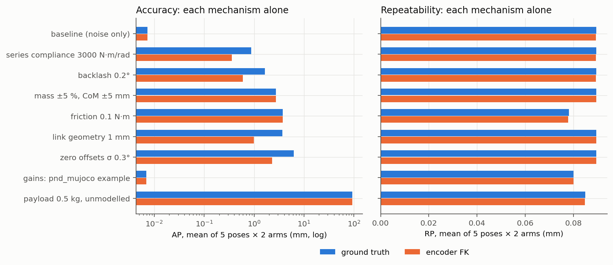
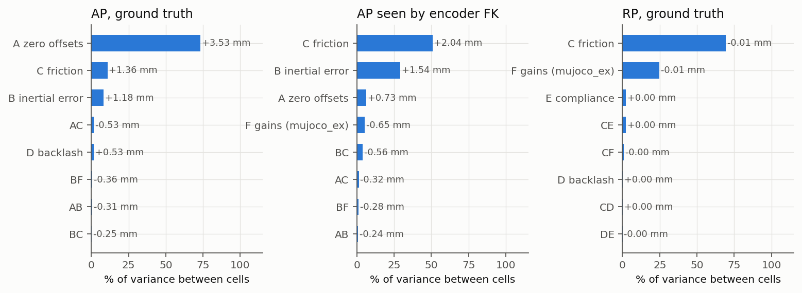
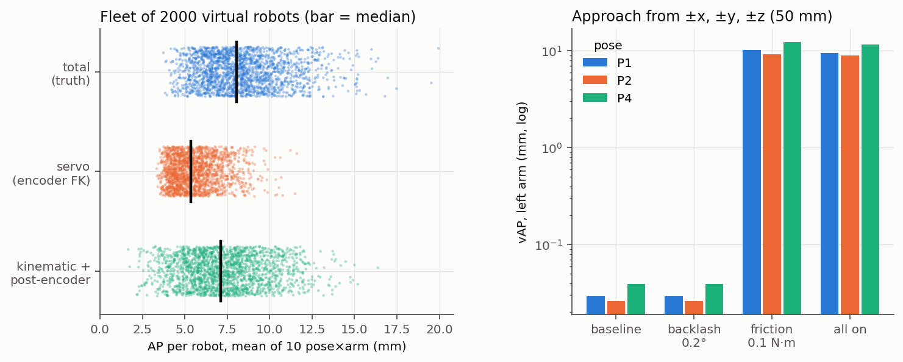
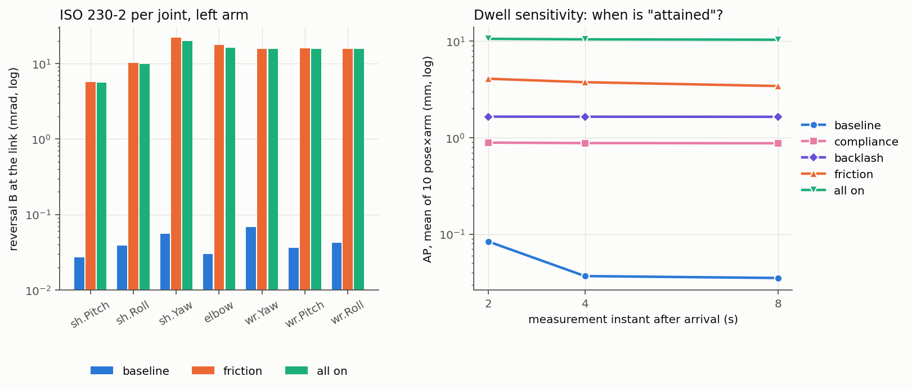

# Results

Generated by `python -m experiments.report` from the JSON files in `results/`. All lengths in mm; AP and RP follow ISO 9283 (see README).

## E0: verification

- Ideal plant (stock dynamics, ideal sensing): bitwise identical across runs = True, RP = 0.0e+00 mm, AP = 0.0035 mm. A perfect simulator returns empty numbers.
- Baseline plant (rotor inertia, encoder quantisation and noise, torque noise, 1 ms latency): AP 0.007 mm, RP 0.085 mm. This is the floor the controller produces before any physical error.
- Instrument RMS error against truth: mocap 0.045 mm, laser tracker 0.008 mm. On the baseline the mocap reads RP 0.121 mm (truth 0.085): the uncertainty ratio is below 4:1 there, so a sub-0.1 mm RP needs a laser tracker.
- Time step: full plant AP 8.854 mm at 1 ms vs 8.855 mm at 0.5 ms; barycentres differ by at most 6.1 µm.

## E1: one mechanism at a time

ISO 9283 cycle P5→P1, both arms, 30 measured cycles per unit. Random mechanisms: mean over units. AP/RP in mm, mean (max) over the 10 pose×arm combinations.

| Mechanism | AP truth | AP encoder FK | AP mocap | RP truth | RP mocap | RP 95 % CI (worst pose) |
|---|---|---|---|---|---|---|
| baseline (noise only) | 0.007 (0.017) | 0.007 (0.017) | 0.011 (0.017) | 0.089 (0.100) | 0.130 (0.148) | 0.078–0.111 |
| series compliance 3000 N·m/rad | 0.875 (1.248) | 0.360 (0.504) | 0.877 (1.252) | 0.089 (0.100) | 0.129 (0.148) | 0.078–0.111 |
| backlash 0.2° | 1.644 (1.918) | 0.599 (0.706) | 1.645 (1.921) | 0.089 (0.100) | 0.129 (0.148) | 0.078–0.111 |
| mass ±5 %, CoM ±5 mm | 2.726 (4.931) | 2.726 (4.931) | 2.727 (4.930) | 0.089 (0.106) | 0.127 (0.143) | 0.078–0.110 |
| friction 0.1 N·m | 3.745 (5.135) | 3.745 (5.135) | 3.745 (5.141) | 0.078 (0.093) | 0.122 (0.135) | 0.073–0.103 |
| link geometry 1 mm | 3.679 (5.360) | 0.995 (1.638) | 3.678 (5.361) | 0.089 (0.106) | 0.127 (0.143) | 0.078–0.110 |
| zero offsets σ 0.3° | 6.222 (7.971) | 2.288 (3.698) | 6.222 (7.972) | 0.089 (0.106) | 0.127 (0.142) | 0.078–0.111 |
| gains: pnd_mujoco example | 0.007 (0.014) | 0.007 (0.014) | 0.010 (0.017) | 0.080 (0.092) | 0.121 (0.147) | 0.071–0.106 |
| payload 0.5 kg, unmodelled | 92.567 (112.107) | 92.567 (112.107) | 92.569 (112.111) | 0.085 (0.093) | 0.126 (0.144) | 0.073–0.104 |

Orientation, hand-to-hand and distance metrics (ground truth, mean over poses and arms; AP_o = |(AP_a, AP_b, AP_c)|, RP_o = max(RP_a, RP_b, RP_c); hand-to-hand = left TCP − right TCP; AD/RD between P2 and P4):

| Mechanism | AP_o (°) | RP_o (°) | hand-to-hand AP | hand-to-hand RP | AD (abs) | RD |
|---|---|---|---|---|---|---|
| baseline (noise only) | 0.002 | 0.0175 | 0.012 | 0.124 | 0.003 | 0.100 |
| series compliance 3000 N·m/rad | 0.116 | 0.0175 | 0.200 | 0.124 | 0.451 | 0.100 |
| backlash 0.2° | 0.342 | 0.0175 | 0.307 | 0.124 | 0.079 | 0.100 |
| mass ±5 %, CoM ±5 mm | 0.554 | 0.0178 | 4.201 | 0.130 | 1.096 | 0.109 |
| friction 0.1 N·m | 0.674 | 0.0163 | 4.562 | 0.105 | 2.061 | 0.065 |
| link geometry 1 mm | 0.201 | 0.0178 | 5.024 | 0.130 | 0.626 | 0.109 |
| zero offsets σ 0.3° | 0.885 | 0.0178 | 6.254 | 0.130 | 0.659 | 0.109 |
| gains: pnd_mujoco example | 0.002 | 0.0168 | 0.010 | 0.114 | 0.005 | 0.096 |
| payload 0.5 kg, unmodelled | 14.661 | 0.0172 | 17.364 | 0.117 | 24.109 | 0.094 |

## E2: 2^(6-1) fractional factorial

32 cells × 30 units × 30 cycles. Factors: A = zero offsets, B = inertial error, C = friction, D = backlash, E = compliance, F = gains (mujoco_ex). Effect = mean(high) − mean(low) of the cell means.

Standard error of every effect from the spread between the units of each cell (t = effect / se).

| Response | se (mm) | Top effects: effect in mm (% of variance, t) |
|---|---|---|
| AP, ground truth | 0.108 | A +3.531 (73 %, t 33), C +1.357 (11 %, t 13), B +1.181 (8 %, t 11), AC -0.531 (2 %, t -5), D +0.525 (2 %, t 5) |
| AP seen by encoder FK | 0.054 | C +2.042 (51 %, t 38), B +1.544 (29 %, t 29), A +0.725 (6 %, t 13), F -0.655 (5 %, t -12), BC -0.559 (4 %, t -10) |
| RP, ground truth | 0.000 | C -0.015 (69 %, t -77), F -0.009 (25 %, t -46), E +0.003 (2 %, t 14), CE +0.003 (2 %, t 14), CF -0.002 (1 %, t -8) |
| AP, virtual mocap | 0.109 | A +3.532 (73 %, t 33), C +1.357 (11 %, t 13), B +1.180 (8 %, t 11), AC -0.530 (2 %, t -5), D +0.525 (2 %, t 5) |
| hand-to-hand AP, ground truth | 0.177 | A +4.914 (60 %, t 28), B +2.923 (21 %, t 16), C +2.151 (12 %, t 12), AB -0.852 (2 %, t -5), AC -0.796 (2 %, t -4) |

RP across the 32 cells: min 0.060 mm, median 0.079 mm, max 0.088 mm.

## E3: the realistic robot

All mechanisms on (zero offsets 0.3°, geometry 1 mm, mass 5 %/CoM 5 mm, friction 0.1 N·m, backlash 0.2°, compliance 3000 N·m/rad), SDK gains.

**Fleet (2000 robots × 3 cycles).** AP (mean over poses): median 8.05 mm, 90th percentile 11.55 mm, worst pose on worst robot 29.26 mm. Virtual mocap agrees with truth to 16 µm.
Split per robot (median): servo 5.36 mm, kinematic + post-encoder 7.13 mm, total 8.05 mm.

**Multi-directional accuracy vAP (left arm, mm).**

| Plant | P1 | P2 | P4 |
|---|---|---|---|
| baseline | 0.029 | 0.026 | 0.039 |
| backlash | 0.029 | 0.026 | 0.039 |
| friction | 10.221 | 9.232 | 12.370 |
| all_on | 9.546 | 8.954 | 11.672 |

**Visit order (all-on plant).**

| Order | AP mean (mm) | RP mean (mm) | RP max (mm) |
|---|---|---|---|
| iso | 10.237 | 0.079 | 0.106 |
| random | 10.449 | 4.831 | 7.752 |

## E4: remaining design blocks

**a. Tool orientation.** The E1 cells with the palm in instead of down (ground truth, mm and °).

| Mechanism | AP palm down | AP palm in | RP palm down | RP palm in | AP_o palm down | AP_o palm in |
|---|---|---|---|---|---|---|
| baseline | 0.007 | 0.043 | 0.089 | 0.092 | 0.002 | 0.009 |
| series compliance | 0.875 | 0.926 | 0.089 | 0.092 | 0.116 | 0.129 |
| backlash | 1.644 | 1.646 | 0.089 | 0.093 | 0.342 | 0.345 |
| mass/CoM | 2.726 | 2.909 | 0.089 | 0.091 | 0.554 | 0.576 |
| friction | 3.745 | 4.206 | 0.078 | 0.077 | 0.674 | 0.762 |
| link geometry | 3.679 | 4.035 | 0.089 | 0.091 | 0.201 | 0.200 |
| zero offsets | 6.222 | 5.789 | 0.089 | 0.091 | 0.885 | 0.731 |
| pnd_mujoco gains | 0.007 | 0.036 | 0.080 | 0.085 | 0.002 | 0.008 |
| payload 0.5 kg | 92.567 | 99.510 | 0.085 | 0.087 | 14.661 | 15.920 |

**b. vAP at the extra poses** (left arm, mm; P6 = arm almost hanging, low gravity load; P7 = arm extended forward). Directions out of reach are skipped.

| Plant | P6 | P7 |
|---|---|---|
| baseline | 0.017 (3 dirs) | 0.017 (2 dirs) |
| backlash | 0.017 (3 dirs) | 0.017 (2 dirs) |
| friction | 6.468 (3 dirs) | 3.655 (2 dirs) |
| all_on | 6.037 (3 dirs) | 3.634 (2 dirs) |

**c. Dwell, stabilisation, overshoot and creep** (ISO cycle with an 8 s dwell; stabilisation band 0.2 mm on the 50 ms-smoothed TCP).

| Plant | AP at 2 s | AP at 4 s | AP at 8 s | max change 4→8 s | stabilisation mean (max), s | overshoot mean (max), mm | creep mean (max), µm/s |
|---|---|---|---|---|---|---|---|
| baseline | 0.084 | 0.037 | 0.035 | 0.052 | 1.25 (1.93) | 3.36 (8.48) | 13 (25) |
| compliance | 0.888 | 0.878 | 0.875 | 0.082 | 1.25 (1.93) | 3.35 (8.47) | 13 (25) |
| backlash | 1.650 | 1.647 | 1.644 | 0.092 | 1.26 (1.94) | 3.29 (8.50) | 13 (25) |
| friction | 4.076 | 3.754 | 3.425 | 0.591 | 5.24 (6.22) | 1.99 (5.61) | 102 (165) |
| all_on | 10.562 | 10.432 | 10.341 | 0.547 | 5.21 (6.07) | 2.00 (5.72) | 105 (160) |

**d. ISO 230-2 per joint** (left arm, 5 targets over ±0.15 rad around P1, 5 bidirectional cycles, 5 s dwell). Reversal B and repeatability R in mrad, read at the link / at the encoder.

| Plant | shoulderPitch | shoulderRoll | shoulderYaw | elbow | wristYaw | wristPitch | wristRoll |
|---|---|---|---|---|---|---|---|
| baseline: B | 0.03 / 0.03 | 0.04 / 0.04 | 0.06 / 0.06 | 0.03 / 0.03 | 0.07 / 0.07 | 0.04 / 0.04 | 0.04 / 0.04 |
| baseline: R | 0.20 / 0.19 | 0.29 / 0.29 | 0.41 / 0.41 | 0.37 / 0.36 | 0.31 / 0.31 | 0.35 / 0.35 | 0.38 / 0.38 |
| compliance: B | 0.03 / 0.03 | 0.04 / 0.04 | 0.06 / 0.06 | 0.03 / 0.03 | 0.07 / 0.07 | 0.04 / 0.04 | 0.04 / 0.04 |
| compliance: R | 0.20 / 0.19 | 0.29 / 0.29 | 0.41 / 0.41 | 0.37 / 0.36 | 0.31 / 0.31 | 0.35 / 0.35 | 0.38 / 0.38 |
| backlash: B | 0.03 / 0.03 | 0.04 / 0.04 | 0.06 / 0.06 | 0.03 / 0.03 | 0.07 / 0.07 | 0.04 / 0.04 | 0.04 / 0.04 |
| backlash: R | 0.20 / 0.19 | 0.29 / 0.29 | 0.41 / 0.41 | 0.37 / 0.36 | 0.31 / 0.31 | 0.35 / 0.35 | 0.38 / 0.38 |
| friction: B | 5.71 / 5.71 | 10.18 / 10.18 | 21.97 / 21.97 | 17.64 / 17.64 | 15.78 / 15.78 | 15.82 / 15.83 | 15.81 / 15.81 |
| friction: R | 5.77 / 5.77 | 10.34 / 10.34 | 22.12 / 22.12 | 17.79 / 17.79 | 16.11 / 16.12 | 16.06 / 16.07 | 16.22 / 16.22 |
| all_on: B | 5.57 / 5.58 | 9.83 / 9.85 | 19.92 / 19.91 | 16.33 / 16.33 | 15.69 / 15.70 | 15.63 / 15.63 | 15.72 / 15.72 |
| all_on: R | 5.70 / 5.72 | 10.69 / 10.72 | 20.09 / 20.09 | 16.51 / 16.51 | 16.03 / 16.03 | 15.89 / 15.90 | 16.15 / 16.16 |

**e. Static compliance at the left TCP** (±1 N along x, y, z; eigenvalues of the symmetric part of the 3×3 compliance matrix, mm/N).

| Controller / plant | P1 | P7 |
|---|---|---|
| sdk | 2.69, 19.59, 24.37 | 0.52, 40.93, 50.15 |
| sdk+spring | 2.70, 19.63, 24.42 | 0.52, 40.97, 50.03 |
| mujoco_ex | 0.96, 17.67, 19.22 | 0.39, 6.73, 22.77 |
| mujoco_ex+spring | 0.98, 17.72, 19.29 | 0.40, 6.86, 22.90 |

